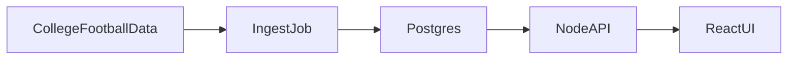

# Clemson Offense Lab

A React and Node app that stores Clemson’s offense from 2008 through 2026 and compares it with the 2018–2020 peak. The subject is the drop after that peak. The code is a small data pipeline, a typed API, and a report you can defend in an interview.


## Architecture



- `client` is a Vite + React + TypeScript site. It talks to `/api`.
- `server` is Express + TypeScript. It reads Postgres and computes the splits.
- `npm run ingest` loads games, drives, plays, season PPA, and havoc from [CollegeFootballData](https://api.collegefootballdata.com/getting-started), then replaces that season in the database.
- Diagnosis rules live in `server/src/diagnosis.ts` and are covered by unit tests. They do not call a model.

Postgres is the right store because games, drives, and plays are related. Docker Compose is enough container setup for an app this size.

## Run it

You need Node.js and Docker Desktop.

1. Copy `server/.env.example` to `server/.env`.
2. Create a CollegeFootballData key at [collegefootballdata.com](https://collegefootballdata.com) and set `CFBD_API_KEY`.
3. From this folder:

```bash
docker compose up -d
npm install
npm test
npm run ingest
npm run dev:server
npm run dev:client
```

Open http://localhost:5173. The API listens on http://localhost:3001. Vite proxies `/api` to it.

`npm run ingest -w server -- 2024` reloads one season. The default is 2008 through 2026. The API caches the database read for 15 seconds.

The Docker database user and password in `docker-compose.yml` are for this local database only.

If you change `server/src/schema.sql` after the first run, reset the volume with `docker compose down -v` and ingest again.

## Publish

The public site is one Node process. In production it serves the built React app and the API on the same port, and it keeps up to five Postgres connections. `render.yaml` describes a small [Render](https://render.com) web service plus a Postgres database. That is enough for light traffic.

1. Commit and push this repo.
2. In Render, create a Blueprint and select the repo. Set `CFBD_API_KEY` when it asks. The key is only needed later, when the live season is refreshed.
3. Copy the local database into Render instead of ingesting again. The CollegeFootballData monthly quota is already used up. From this folder, with the Render external database URL:

```bash
docker exec clemson-offense-db pg_dump -U clemson -d clemson_offense --no-owner --no-acl -f /tmp/clemson.sql
docker cp clemson-offense-db:/tmp/clemson.sql clemson.sql
docker run --rm -v "%cd%:/dump" postgres:16-alpine psql "RENDER_DATABASE_URL" -f /dump/clemson.sql
```

On PowerShell, replace `%cd%` with `${PWD}`.

Do not commit `clemson.sql`. After the quota resets, refresh 2024–2026 against the hosted database with `DATABASE_URL` set to the Render URL and `npm run ingest -w server -- 2024 2025 2026`. The Sunday task on this PC still updates the local database only.

## Pages

- **Overview** shows the season trend and a table of every season.
- **Season** shows down, pass/rush, and red-zone splits, plus the game log.
- **Method** defines every measure and the cutoff that creates a finding.

## Measures

Scrimmage plays are rushes and passes, including sacks and interceptions thrown. Kickoffs, punts, returns, field goals, extra points, penalties, two-point tries, kneels, and spikes are excluded. Spring games are not ingested.

- **Success rate:** at least 50% of the distance on first down, 70% on second, and the full distance on third or fourth. A distance under one yard counts as one.
- **Explosive play rate:** scrimmage plays of 15 yards or more.
- **Early-down success rate:** success rate on first and second down.
- **Points per drive:** scoreboard points the offense added, divided by drives. Scoreless end-of-half and end-of-game drives are left out.
- **Red zone score rate:** drives that start inside the opponent 20, or have a scrimmage play there, and end in a touchdown or made field goal.
- **PPA per play:** CollegeFootballData’s season offensive predicted points added. If it is missing, the average PPA on scrimmage plays is used. The game log always uses the play average.
- **Havoc rate allowed:** CollegeFootballData’s rate of tackles for loss, forced fumbles, and passes defended. Higher is worse. It is stored on the `season_ppa` row with the season PPA.
- **Opponent defense PPA:** CollegeFootballData’s `defense.overall` for that game’s opponent, the predicted points added per play by offenses facing that defense. Lower is a tougher defense. The season number averages games that have a rating and skips an unrated opponent. It is stored on the game as `opponent_defense_ppa`. The overview baseline for this column is the unweighted average of the 2018, 2019, and 2020 season values. Hiding garbage time does not change it.

The baseline for the offense rates is the unweighted average of 2018, 2019, and 2020. A later season is flagged only when the gap clears a cutoff and the sample is large enough. The cutoffs are in `server/src/diagnosis.ts` and on the Method page. Opponent defense PPA is not one of those findings.

The offense rates are not rewritten for opponent. Opponent defense PPA is shown beside them. Garbage time can be hidden from the header. The report describes what changed. It does not prove why.

2024, 2025, and 2026 have no opponent defense rating yet. The CollegeFootballData monthly call quota ran out while those seasons were loading, and 2008–2023 are already filled. When the quota resets, reload only the missing seasons:

```bash
npm run ingest -w server -- 2024 2025 2026
```

## API

- `GET /api/seasons` — seasons on file and the headline offense numbers
- `GET /api/seasons/:year` — splits for that season: down, pass or rush, red zone
- `GET /api/seasons/:year/games` — game log
- `GET /api/diagnosis` — baseline versus later seasons, with the findings
