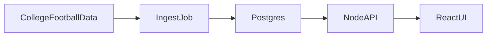

# Clemson Offense Lab

A React and Node app that stores Clemson’s offense from 2008 through 2026 and compares it with the 2018–2020 peak. The subject is the drop after that peak. The code is a small data pipeline, a typed API, and a report you can defend in an interview.


## Architecture



- `client` is a Vite + React + TypeScript site. It talks to `/api`.
- `server` is Express + TypeScript. It reads Postgres and computes the splits.
- `npm run ingest` loads games, drives, plays, season PPA, and havoc from [CollegeFootballData](https://api.collegefootballdata.com/getting-started), then replaces that season in the database.
- Diagnosis rules live in `server/src/diagnosis.ts` and are covered by unit tests. They do not call a model.

Postgres is the right store because games, drives, and plays are related. Docker Compose is enough container setup for an app this size.

## Run it

You need Node.js and Docker Desktop.

1. Copy `server/.env.example` to `server/.env`.
2. Create a CollegeFootballData key at [collegefootballdata.com](https://collegefootballdata.com) and set `CFBD_API_KEY`.
3. From this folder:

```bash
docker compose up -d
npm install
npm test
npm run ingest
npm run dev:server
npm run dev:client
```

Open http://localhost:5173. The API listens on http://localhost:3001. Vite proxies `/api` to it.

`npm run ingest -- 2024` reloads one season. The default is 2008 through 2026. The API caches the database read for 15 seconds.

The Docker database user and password in `docker-compose.yml` are for this local database only.

If you change `server/src/schema.sql` after the first run, reset the volume with `docker compose down -v` and ingest again.

## Pages

- **Overview** shows the season trend and a table of every season.
- **Season** shows down, pass/rush, and red-zone splits, plus the game log.
- **Method** defines every measure and the cutoff that creates a finding.

## Measures

Scrimmage plays are rushes and passes, including sacks and interceptions thrown. Kickoffs, punts, returns, field goals, extra points, penalties, two-point tries, kneels, and spikes are excluded. Spring games are not ingested.

- **Success rate:** at least 50% of the distance on first down, 70% on second, and the full distance on third or fourth. A distance under one yard counts as one.
- **Explosive play rate:** scrimmage plays of 15 yards or more.
- **Early-down success rate:** success rate on first and second down.
- **Points per drive:** scoreboard points the offense added, divided by drives. Scoreless end-of-half and end-of-game drives are left out.
- **Red zone score rate:** drives that start inside the opponent 20, or have a scrimmage play there, and end in a touchdown or made field goal.
- **PPA per play:** CollegeFootballData’s season offensive predicted points added. If it is missing, the average PPA on scrimmage plays is used. The game log always uses the play average.
- **Havoc rate allowed:** CollegeFootballData’s rate of tackles for loss, forced fumbles, and passes defended. Higher is worse. It is stored on the `season_ppa` row with the season PPA.

The baseline is the unweighted average of 2018, 2019, and 2020. A later season is flagged only when the gap clears a cutoff and the sample is large enough. The cutoffs are in `server/src/diagnosis.ts` and on the Method page.

These rates are not opponent-adjusted, and garbage time stays in. They describe what changed. They do not prove why.

## API

- `GET /api/seasons` — seasons on file and the headline offense numbers
- `GET /api/seasons/:year` — splits for that season: down, pass or rush, red zone
- `GET /api/seasons/:year/games` — game log
- `GET /api/diagnosis` — baseline versus later seasons, with the findings
